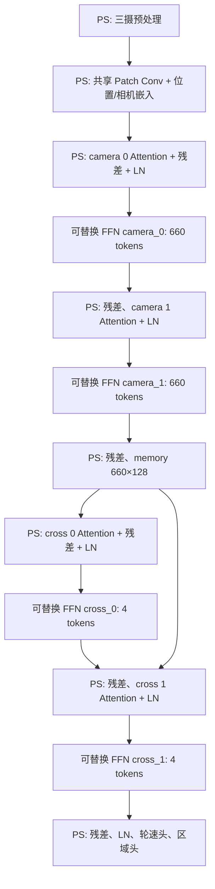

# 文件分析与迁移决策（2026-10-14）

## 1. 结论与审查边界

这个文件夹不是从零开始的 FPGA 工程，而是 **PyTorch 训练代码 + ROS 1 小车程序 + 三摄录制数据 + 已完成的 KV260 CPU 离线迁移及历史验收证据**。本次新增 `pynq_ffn/`，不覆盖上述原始资料。

本次“完整分析”指完整目录分类、核心自有源码分析、数据 CSV 全量结构检查及重要文档交叉核验；**不等于逐张审阅全部图像、审计所有第三方库、反编译二进制或复验板卡**。所有硬件状态均注明证据日期，不把历史记录当作今天的现场测量。

| 原目录 | 内容与角色 | 本次检查深度 |
|---|---|---|
| `__init__ (2)/` | 12 个 Python 文件，约 158 KiB；模型、数据、训练、评估、导出 | 12 文件全量阅读、AST 语法检查 |
| `ros_craic_car/` | ROS 1 小车工程、依赖、生成物、模型及录制资料 | 25,235 文件条目分类；自有 7 包的 16 个 cpp、7 个 h、6 个 launch、2 个 msg 全读；13 个 package.xml/CMake 有效项检查；关键依赖抽读 |
| `kv260_v1/` | 离线 CPU 应用、部署包、测试、板端验收/诊断证据 | 应用和测试、模型结构、重要报告/验证记录分析；不执行旧运维脚本、不读取泄露凭据 |
| `Database/` | 六个训练/采集数据 ZIP | ZIP 全部目录项、426 个 CSV 全读；54 张 JPEG 头部抽样 |
| `doc/` | 三份 Markdown 项目报告，共 121,902 B | 全文阅读；以 10 月 13 日交接及 10 月 9 日实际模型合同为优先 |
| `.gitignore` | 758 B | 阅读；根目录没有 Git 仓库 |

ROS 文件条目的可 stat 总大小为 1,483,328,954 B，包含依赖/构建物及 8 条不能追随的符号链接，不代表全是自有源码。未编译 ROS，也未启动相机、串口或底盘。

## 2. 应优先相信哪些文件

1. `doc/KV260_项目完整交接_20261013.md`：最新汇总，最近板端检查日期为 2026-10-12。
2. `doc/KV260_最终推理工程迁移计划.md`：2026-10-09，冻结实际 NUC/模型/预处理合同。
3. `kv260_v1/artifacts/pynq_20261011_task12/任务一二_验证报告.md`：CPU/PYNQ 分层验收与失败证据。
4. `kv260_v1/app/infer_recording.py`：当前可复用的离线 PS 行为基线。
5. `__init__ (2)/model.py` 与真实 ONNX：架构/权重的直接依据。

`doc/ViT_KV260_迁移与竞赛实施分析报告.md` 是早期设计分析，部分旧主机、缺权重判断及新串口协议设想已过时，不能直接当现在的实施要求。历史文档中的工作站绝对路径也不保证本机存在。

## 3. 模型与实际数据流

### 3.1 固定模型

- 来源：`kv260_v1/v1_payload.zip` 的 **唯一指定成员** `model/model_current.onnx`。
- 大小：2,779,255 B；内嵌权重；IR 8、opset 17，PyTorch 2.4.1 导出。
- SHA-256：`ad58d1fc9168da94b9ce076ba8cc9754c371ead87974da8bc9cc601ad1650d5b`。
- 输入：float32 `images [1,3,3,66,200]`。
- 输出：`speed_norm`、`speed_raw`、`region_logits`、`region_probs`；实际轮速使用 `speed_raw [1,2]`。
- 本次迁移只接受这个哈希。重新训练/导出的模型需要重新审查图边界，不能只改文件名绕过校验。

### 3.2 数据处理不可改动的细节

`kv260_v1/app/infer_recording.py` 的 `preprocess_arrays` 与 `infer_speed` 是当前部署基准：

1. 三张 `640×480`、uint8、BGR 图像。
2. CSV 三路列通常是 **front,left,right**，模型张量顺序却是 **left,front,right**。
3. 裁剪 `image[150:479, 0:640, :]`，即高 329；最后一行不使用。
4. `INTER_LINEAR` 缩放到 `200×66`，然后 BGR 转 YUV。
5. float32 `/255 - 0.5`；转 CHW、堆成 `[1,3,3,66,200]`。
6. `speed_raw` 已还原到当前模型 `[-500,500]`，**不能再乘 300 或 500**。

训练 `data.py` 使用 `INTER_AREA`，与已部署 C++/v1 的 `INTER_LINEAR` 不一致。本轮遵守部署基准，不趁迁移擅自改变输入分布。`evaluate.py` 即使选择 ONNX 仍有顶层 PyTorch 依赖，因此不把整份训练脚本搬进板端运行时。

### 3.3 模型结构



共享 Patch Conv 为 `3→128`，kernel=stride=`(6,10)`，每摄 `11×20=220` tokens。三摄共享 **同一套** 两层 camera encoder 权重，执行形状为 `[3,220,128]`，不是三套独立 encoder。合并后 memory 为 `[1,660,128]`；四个任务 token 经过两层 cross-attention。

四组目标 FFN 均为：

```text
U = X @ W1 + b1       W1 [128,256], b1 [256]
V = 0.5 * U * (1 + erf(U / sqrt(2)))
Y = V @ W2 + b2       W2 [256,128], b2 [128]
```

ONNX 矩阵已经是右乘布局，不能再按 PyTorch Linear 权重习惯无条件转置。Dropout 在推理中关闭；LayerNorm 和残差明确留在 PS；速度头和区域头中的 Linear 不属于本次四组 FFN。

## 4. 为什么这样划分 PS/PL

| PS 保留 | PL 目标 |
|---|---|
| JPEG 解码、裁剪、缩放、颜色转换 | 两次矩阵乘法 |
| Patch embedding、位置/相机 embedding | 两次 bias 加法 |
| self/cross attention、softmax、LayerNorm | 与原模型一致的 GELU |
| 残差与跨 stage memory 生命周期 | 输入/输出 AXI 访存 |
| 任务 token、轮速/区域输出头 | 同一核复用四套权重 |
| 参数、计时、异常处理、未来车控安全层 | 不直接控制车辆 |

用 ONNX Runtime 执行五段 PS 子图，四个 FFN 插入后端。先比较 `golden` 整图、`split-ort` 分图、`split-numpy` 软件替身，再接 PYNQ。分图保存真实跨段 live tensors，特别是供两个 cross 层共用的 memory，以及每个 FFN 外的残差；并非仅把前一段输出逐段串起来。

这是**可验证的功能边界**，不是已经优化到实时性能的方案。分图会破坏部分 ORT 融合、增加 Python 调度与缓冲区开销；是否加速必须靠板上端到端实测。

## 5. FFN 算量与流水线重点

- 每组 FFN：65,536 个权重、384 个偏置，共 65,920 float32，即 263,680 B。
- 四组总参数：263,680 个，即 1,054,720 B。
- 每 token：`128×256 + 256×128 = 65,536 MAC`。
- 每帧：`(660×2 + 4×2)×65,536 = 87,031,808 MAC`，不含激活/LN。
- camera 两组占 FFN MAC 约 **99.4%**；cross 两组只占约 **0.6%**。
- 四次 FFN 输入输出的最低有效载荷约 **1,359,872 B/帧**，不含权重加载、其他 PS 张量、缓存同步/AXI 协议。

建议先以 cross 的 4 tokens 验证 ABI 和数值，再集中优化 camera 的 660 tokens。量化、GELU 近似、矩阵重排是第二阶段，每次只改一个变量，必须重跑精度验收。FFN 占 MAC 的比例不能当占耗时比例；不能据此承诺端到端加速比或 15 Hz。

## 6. 数据集盘点与限制

| ZIP | JPEG | CSV | 有标签三摄组 |
|---|---:|---:|---:|
| `record_data_26.5.10.zip` | 15,699 | 59 | 5,233 |
| `record_data_5.15.zip` | 17,064 | 60 | 5,688 |
| `record_data_5.16.zip` | 19,206 | 59 | 6,402 |
| `record_data_5.17.zip` | 7,209 | 35 | 2,196 |
| `record_data_5.23.zip` | 19,383 | 125 | 6,413 |
| `record_data_5.30.zip` | 13,323 | 88 | 4,441 |
| 合计 | 91,884 | 426 | 30,373 |

六 ZIP 合计 5,248,906,937 B；内部 92,310 个文件和 1,709 个目录项。426 份 `joystick.csv` 全部解析；无表头五列，三个图路径和两个有限轮速值，全部引用存在。抽查 54 张 JPEG 头部均为 640×480、8-bit、3 分量；**没有逐张解码/CRC 验证全部图像**。

发现：

- 11 份空 CSV，其中 3 个会话有图却没有标签，共 **255 组三摄 / 765 张图**。不能把缺标签填零。
- 3 行左轮为负数，位于 5.30 包 `1780150571/joystick.csv` 第 3～5 行；应纳入协议和数值边界测试。
- 没有区域标签、逐帧采集时间、正式 train/validation/test 清单；文件编号对应不证明相机时间同步。
- 数据有明显分布集中，9,645 行恰为 `(200,200)`；应按会话/日期划分独立测试，不随机打散相邻帧制造泄漏。
- `Database/joystick.csv` 与 ROS 录制的 `auto_data.csv` 是不同数据来源。后者是既有模型的输出，不能充当独立驾驶真值。
- ZIP 外层目录结构不一致；应相对 CSV 父目录解析图像路径。

## 7. 现有 PYNQ 状态：软件能导入不等于硬件能算

以下是 **2026-10-11 报告及 10-13 交接记录**，本轮没有连接板卡复测：

- KV260/K26、Zynq UltraScale+ MPSoC、4×A53、4 GiB DDR。
- Ubuntu 22.04.4 / Python 3.10.12 / PYNQ 3.0.1 / XRT 2.13 系列。
- 原应用独立环境：NumPy 1.26.4、OpenCV 4.10.0、ORT 1.20.1。
- CPU 离线回放：173 组三摄，四线程平均推理 64.67 ms、整组计算 95.74 ms、完整离线吞吐 10.38 组/s。这不是实车或 PL 数据。
- 小 CPU 缓冲区读写、HWH 解析和 xclbin 元数据成功；完整 base overlay 加载失败。
- 记录显示 `cma=1000M` 启动预留失败、`CmaTotal=0`；普通空闲 RAM 多不代表 DMA 连续内存足够。
- `cma=256M` 是尚未实施的受控恢复建议，**不是本次已修复项**。须确认真实 boot 参数生成源、维护窗口、回退手段后处理，不能盲改 GRUB 或重启。
- 历史 `xclbinutil` 路径绕过仅修复工具调用，不解决 CMA。某 profile 会插入设备树，不能把 `source /etc/profile.d/pynq_venv.sh` 称作只读检查。

本次新工具 `tools/board_preflight.py` 只读本机文件/包元数据，不导入 PYNQ、不创建 Overlay、不更改设备树，也不认证硬件可用。

## 8. 不能直接复制上板的 ROS 部分

重点证据在 `ros_craic_car/src/base_control/src/{base_control,hawking_e2e,serial_sender}.cpp`：

1. `base_control.cpp` 全局构造串口对象，进入 main 前就可能打开 `/dev/ttyUSB0`；不能为“看看能否运行”直接启动。
2. 原路径 `/home/biguy/...`、x86 `build/devel` 和二进制不能直接搬到 ARM64。
3. `SendSideSpeed` 固定方向位却直接拼有符号数字，缺乏范围/NaN/ACK 验证；负数会破坏原三位数字域。
4. “停止”若只置 speed=0 而角度非零，现有转向混控仍可能产生左右相反的非零命令，不是可靠急停。
5. 自动循环缺图像时效/同步保护，切模式/退出未见明确停车保障。
6. 相机 launch 没设置帧率，驱动默认约 10 Hz；`ros::Rate(15)` 不会凭空产生 15 Hz 新鲜同步三摄。
7. USB 摄像头、Linux joystick、USB 串口 MCU 是不同外设链路，不应未经核实改为 GPIO/PWM/MIPI。

因此本轮 PS 交付以**离线文件输入与数值输出**为范围。实时相机/ROS 与底盘控制属于下一道独立安全验收；需要确认三摄设备映射、STM32 协议、速度单位/方向位、超时停车和物理急停后实施。新包没有打开串口、控制电机或自动接管车辆的代码。

## 9. 可复现性与未确认项

- 原 `.gitignore` 排除了 `.onnx/.bit/.hwh/.dtbo/.xclbin/.pth` 等；正式发布要另附模型/硬件哈希清单，不能指望默认 git add 收齐。
- 当前板卡是否仍为交接中的 KV260、当前 CMA/启动固件状态、可用维护窗口，需现场确认。
- Vivado 工程必须按实际 SOM part/速度等级建工程；不从“PYNQ”这个软件名字推断器件。
- 没有本轮综合、布局布线、时序、资源或功耗报告；没有新的 bit/hwh；没有板上加速验收。
- 未核实区域头的训练有效性、量化容差与最终比赛截止/精度/FPS验收标准。
- 历史日志有凭据暴露风险；本轮不提取、不复用、不传播这些秘密，不自动登录板卡。

## 10. 源码模块逐项职责与定位

### 10.1 训练目录十二个 Python 文件

| 文件 | 实际职责 | 是否属于本次板端必要运行时 |
|---|---|---|
| `__init__.py` | 包入口 | 否 |
| `config.py` | 输入/模型/训练/路径参数；默认数据目录不等于当前真实数据位置 | 提取合同，不整份依赖 |
| `model.py` | 三摄共享编码器、cross attention、轮速/区域头 | 已通过固定 ONNX 固化 |
| `data.py` | CSV、裁剪、增强、memmap缓存、Torch Dataset | 仅移植部署一致预处理 |
| `dataset_paths.py` | checkpoint/run/data输出路径推导 | 否 |
| `train.py` | AdamW训练、恢复、checkpoint、曲线 | 留训练主机 |
| `export_onnx.py` | 导出四输出、轮速反归一化、元数据 | 留准备/训练主机 |
| `predict.py` | 单组三摄PT推理 | 用新ORT入口替代 |
| `evaluate.py` | PT/ONNX数据评估及图表，仍依赖Torch | 不作为轻量PS入口 |
| `visual_calibrator.py` | Tk图片检查、裁剪、attention/Grad-CAM | 留主机 |
| `torch_utils.py` | 设备、AMP、CUDA后端 | 不需要 |
| `progress.py` | 终端进度输出 | 不需要 |

`model.py:88-116` 定义共享编码器，`:147-190` 给出实际token流；`data.py:65-83` 是训练预处理；`export_onnx.py:24-37` 是输出尺度处理（这些为1基源码行号）。训练默认区域loss未启用，却仍导出区域输出，应区分数值保留与任务有效性。

训练默认按单帧随机划分train/val，可能让相邻帧跨集合；memmap缓存也不是按图片内容hash完整失效。后续若做精度/泛化结论，要先修数据划分与缓存审计，本次不改训练过程或重训。

### 10.2 ROS 自有七包

| 包 | 实际角色 | 关键迁移限制 |
|---|---|---|
| `base_control` | 手动/自动切换、三摄、ORT、串口、录制/回放 | 当前入口有真实硬件副作用；`data_review`也会发串口，不是离线查看器 |
| `joystick_manager` | Linux joystick读取、Qt状态显示 | `/dev/input/js0`映射/失联行为要现场核验 |
| `joystick_control` | Joy到速度/转角/录制标志 | 轴/按钮边界与控制仲裁未冻结 |
| `joystick_wheel` | 方向盘reader、Qt展示 | 每次事件重建零Joy会丢保持状态；实际发布Joy不是自定义Wheel |
| `joystick_wheel_manager` | 档位、启动/停止、转向混控 | 停止状态不保证所有轮速为零 |
| `mulit_camera_manager` | 三摄launch、映射GUI | 名称按现有拼写；GUI不是相机内外参标定 |
| `RoadSign_param_server` | 另一套YOLO，发布路标布尔参数 | 当前base不消费，话题也未与三摄统一 |

第三方 `usb_cam`、`serial`、`vision_opencv` 不需要改成PL；它们是Linux驱动/ROS适配链路。`.kilocode/node_modules`、`build/devel/devel_isolated`、对象文件与旧`.bak`不是ARM部署输入。

### 10.3 有直接证据的优先风险

| 位置（相对工作区） | 问题与证据 |
|---|---|
| `ros_craic_car/src/base_control/src/base_control.cpp:32` | 全局串口对象可能在main前打开设备 |
| `ros_craic_car/src/base_control/src/base_control.cpp:186` | 实际Predict传left/front/right，不能按被误命名的形参反转 |
| `ros_craic_car/src/base_control/src/base_control.cpp:277` | 转角缩放参与停止时的混控问题 |
| `ros_craic_car/src/base_control/src/serial_sender.cpp:27-49` | speed为0但角度非零时可能输出对向非零轮速 |
| `ros_craic_car/src/base_control/src/serial_sender.cpp:63-81` | 自动报文固定方向位、直接拼有符号速度；部分写入语义不可靠 |
| `ros_craic_car/src/base_control/src/hawking_e2e.cpp:76-79` | 缺speed_raw时fallback到首输出，可能误用归一化值 |
| `ros_craic_car/src/base_control/src/hawking_e2e.cpp:341-362` | 旧单摄路径三通道缓冲按步长9写入，存在越界风险，不应启用 |
| `ros_craic_car/src/joystick_wheel/src/wheel_reader.cpp:52-75` | 单次事件更新导致持久轴/按钮状态丢失 |
| `ros_craic_car/src/usb_cam/src/camera_driver.cpp:39-48` | 没有launch帧率参数时驱动默认10Hz |
| `ros_craic_car/src/base_control/CMakeLists.txt:23-25` | ORT硬编码x64路径，不能原样在ARM链接 |

还发现无相机/手柄时效保护、无明确模式切换/退出停车、多个控制源无仲裁、过滤值未实际用于下发、旧单摄/9通道备份与现模型不兼容。以上是审查发现，**本次未擅自修复或启动车辆工程**；新包通过完全不打开设备，隔离这些风险。
